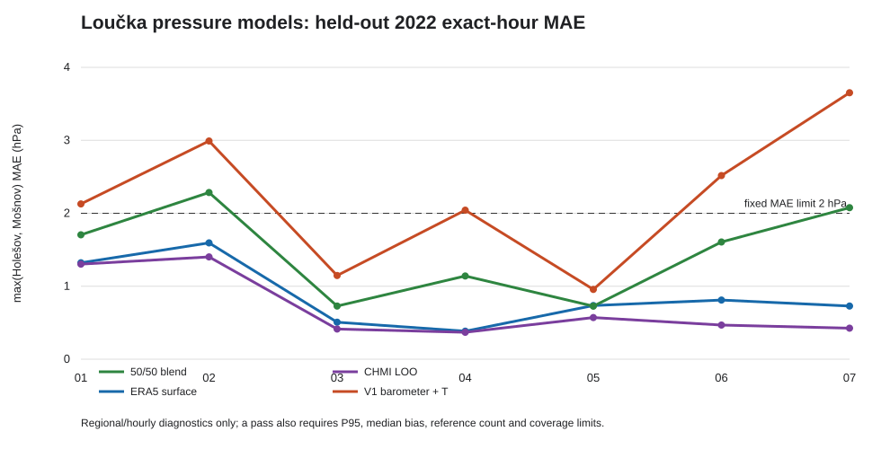

# Loučka tlak: QC barometru a ERA5 v2

**Snapshot:** 24. 11. 2026 UTC · **stav:** diagnostika a samostatný katalog návrhů `UNAPPROVED` · **žádné SQL zápisy.**

## Rozhodnutí

Vstupní barometr má být v celé historii nejprve kontrolován na izolované reversní výkyvy. Scan tří dostupných archive tabulek označil 54 hodnot v produkci, 54 v rekonstrukci a 425 v kopii WH1080. Původní data zůstala beze změny. Dva z označených bodů v rekonstrukci přímo vstoupily do V1 návrhu: 29. 3. 2022 22:10 a 23:10 UTC. V1 z nich vytvořil 954.3085 a 953.5508 hPa; lokální barometr přitom spadl přibližně o 5.36/5.49 hPa a během pěti minut se vrátil. V katalogu v2 jsou tyto dvě hodnoty `UNRESOLVED`, nikoli odhady.

ERA5 surface pressure prošel nezměněným dvoustaničním hodinovým gate pro 6 ze 7 měsíců ledna až července 2022. Model vybraný pouze na 2021 bloku přidává 3,082 hodinových návrhů. Únor neprošel: Mošnov median bias je +1.511 hPa, tedy mírně nad pevným limitem 1.5 hPa. Následný test regionálního ČHMÚ transferu metodou leave-one-station-out prošel všech 7 měsíců 2022, ale na jediném způsobilém výběrovém měsíci 2021 měl vyšší MAE; podle předem definovaného pořadí modelů nebyl vybrán. Tyto alternativní výsledky se nepoužily k dodatečnému výběru podle testu.

Všechny modelové hodnoty zůstávají mimo databázi, `ESTIMATED / UNAPPROVED`. Hodinová ERA5 řada není pětiminutové měření. Q1 2018 je výslovně chráněno; v žádné části v2 pro něj nejsou návrhy.

## Uchování V1 a výstupů v2

V1 CSV i `evidence.json` z původního dočasného běhu zůstaly beze změny v repozitáři a mimo `/tmp` v `/opt/meteo-audit-artifacts/pressure-shadow-2022-v1/`.

| Artefakt | SHA-256 |
|---|---|
| V1 `evidence.json` | `50f33ebb3883e865d06234938ce33049c6c7596e76823ac178231c32ecfec8f7` |
| V1 `pressure-shadow-unapproved.csv` | `d4ac993dae6a640e01049e733e0ff23f61900f129347359ca1c694b1a42e5179` |
| ERA5 72-response manifest | `f5a2daa2ad903183614b9f1dbc091b33c08d6e37df323da55c6b834c0302798c` |
| ČHMÚ 2009–2026 cache manifest | `3c935d0a134a6cd351fe1915cb0a720cf47bed4dc8fc18c0e7d88ece4b72409e` |
| Barometrický QC v2 (celý interval) | `818531c34f990ad0477e2fae22fec75f28b2a9c2fb604135015e3c9058ae1b0a` |
| ERA5/ČHMÚ validace v2 | `38121026d8d1f96af55aeef1aef97e384d4a7148a4307ef3a17403d381b1819f` |
| Sloučený v2 katalog (lokálně, neveřejný) | `53db52470e8271b288bada8205ea3ec91c11b96423869b22f6c9d8513f0a126e` |
| Jednotná řada všech archive timestampů (gzip, lokálně) | `338dd3eb8128bf9ff9335f6216ab7eaff5e2edf82f9d24dde3f5ab5bed04ce4a` |

Detailní výsledné řádky kandidátů, úplná jednotná řada, celé API odpovědi a seznam jednotlivých podezřelých časů zůstávají v `/opt/meteo-audit-artifacts/pressure-reanalysis-v2/`, mimo Git. Veřejné agregáty jsou v [ERA5/ČHMÚ validaci](data/pressure-reanalysis-v2/pressure-reanalysis-validation-v2.json), [QC souhrnu](data/pressure-reanalysis-v2/barometer-qc-summary.json), [provenienci zdrojů](data/pressure-reanalysis-v2/source-provenance.json), [ročním inventáři](data/pressure-reanalysis-v2/annual-status-inventory-v2.json) a [manifestu lokálních souborů](data/pressure-reanalysis-v2/candidate-output-manifest.json). V Git jsou skripty, testy, souhrny a tento report; zdrojové meteorologické řady nebyly publikovány.

## Kontrola barometru 2009–2026

Pravidlo je předem pevné: hodnota musí být v rozmezí 800–1100 hPa a mít sousední skok nejméně 3 hPa na obě strany, opačná znaménka a návrat k předchozí hodnotě do 1.5 hPa; každý sousední interval nejvýše 15 minut. Jsou to **podezřelé**, nikoli automaticky opravené hodnoty. Scan zahrnul celé datumové rozmezí od 1. 1. 2009 do 25. 11. 2026 UTC.

| Zdroj | Řádků | Chybějící barometr | Mimo široký rozsah | Nesoulad jednotek | Podezřelé izolované reversní hodnoty |
|---|---:|---:|---:|---:|---:|
| `pocasi-loucka.eu` | 1,687,205 | 8,341 | 0 | 0 | 54 |
| `loucka_reconstruction` | 1,697,604 | 18,739 | 0 | 0 | 54 |
| `weewx_WH1080` | 1,112,201 | 6,098 | 0 | 0 | 425 |

Rekonstrukce a produkce mají shodných 30 výkyvů v lednu až červenci 2022 (3 v březnu, 27 v dubnu); březnové dva body jsou uvedené výše. Historická kopie WH1080 není nezávislým hardwarem GW1000. Počty lokálních/rekonstrukčních/WH reversí v letech 2016/2017 jsou 6/11 a 129/240. Proto jsou hodnoty z tohoto zdroje v driftové epoše vyloučeny z automatické rekonstrukce.

Z 15,166 V1 kandidátů přežilo vstupní QC 15,164. Původní časová kontinuita a rozsahy (březen 6,880 řádků, rozsah 953.5508–991.3134 hPa, 6,786 sousedních pětiminutových párů, nejdelší mezera 21 h 30 min; květen 8,286, rozsah 956.4849–977.8390 hPa, 8,203 párů, mezera 4 h 50 min) pochází z původního read-only auditu. Dva březnové kandidáty QC vyřadil. Zbylé hodnoty si ponechávají omezení: pouze 54/38 blízkých měřených sousedů v okně ±1 h a žádný hustý pětiminutový externí holdout. Jejich pětiminutová přesnost tak zůstává neověřena.

## Reanalýza a provenience

Bylo staženo 72 ročních JSON odpovědí Open-Meteo Historical Weather API: 4 body (nejbližší a sousední bod Loučky, body Holešova a Mošnova), 2009–2026. U každé odpovědi i manifestu jsou ověřitelné SHA-256. Požadované proměnné jsou `surface_pressure`, `pressure_msl` a `temperature_2m`; API vrátilo tlak v hPa, teplotu v °C, čas UTC a elevation metadata jednotlivých bodů. Roky 2009–2025 jsou úplné; 2026 končí kvůli publikačnímu zpoždění zhruba 18. 11. 2026. API body jsou ERA5 0.25° modelové buňky, nikoli souřadnicová bodová měření. Pro výškový transport se použila vrácená výška buňky (Loučka nejbližší 480 m, sousední 399 m, Holešov 272 m, Mošnov 383 m), teplota 2 m a hydrostatická hypsometrická relace; pro Loučku cílová výška 425 m.

`pressure_msl` je tlak redukovaný na hladinu moře a porovnával se pouze s ČHMÚ `P_hm`. `surface_pressure` je tlak u modelového povrchu a po výškovém transportu se porovnával s ČHMÚ staničním `P`. Tyto veličiny nebyly zaměňovány.

Oficiální katalog ERA5 uvádí hodinová jednopodlažní pole od 1940, rozlišení 0.25° a obě tlakové proměnné ([ERA5 single levels](https://cds.climate.copernicus.eu/datasets/reanalysis-era5-single-levels-timeseries?tab=download)). ERA5-Land poskytuje hodinový surface pressure v Pa, nominálně 0.1°/9 km, od 1950; `MSLP` v tomto produktu není ([ERA5-Land katalog](https://cds.climate.copernicus.eu/datasets/reanalysis-era5-land-timeseries?tab=download), [oficiální ARCO proměnné](https://confluence.ecmwf.int/pages/viewpage.action?navigatingVersions=true&pageId=737567208)). Open-Meteo ERA5-Land API pro kontrolované dotazy vracelo tlakové proměnné null; přímý autentizovaný CDS/ARCO přístup vyžaduje přijetí podmínek a uživatelský klíč ([CDS API](https://cds.climate.copernicus.eu/en/how-to-api)). Klíč v LXC dostupný nebyl. ERA5-Land proto nebylo možné stáhnout ani prohlásit za porovnaný zdroj.

ČHMÚ cache obsahovala 360 hodinových souborů `P`/`P_hm` Holešov a Mošnov; všech 360 hashů souborů bylo ověřeno. Identifikátory jsou WSI `0-20000-0-11774` a `0-20000-0-11782`. Metriky jsou pouze pro quality-zero záznamy.

### ERA5 přesnost proti stanicím

V úplných letech 2018–2024 byl pro povrchový tlak nejprve proveden transport z vrácené výšky ERA5 buňky do nadmořské výšky stanice, poté srovnání s ČHMÚ `P`.

| Stanice | Hodinových dvojic/rok | MAE za 2018–2024 | Median bias rozsah | P95 absolutní chyby rozsah |
|---|---:|---:|---:|---:|
| Holešov | 8,689–8,779 | 0.291–0.321 hPa | −0.028 až +0.090 hPa | 0.743–0.822 hPa |
| Mošnov | 8,688–8,780 | 0.576–0.701 hPa | +0.528 až +0.681 hPa | 1.207–1.361 hPa |

ERA5 `pressure_msl` proti ČHMÚ `P_hm` dává v těchto letech MAE 0.346–0.421 hPa, P95 0.9–1.1 hPa, zhruba 8,688–8,780 dvojic ročně. To ověřuje MSLP reanalýzy, ne staniční tlak Loučky. Rozdíl sousední a nejbližší Loučka grid cell je samostatně veden jako prostorová citlivost, nikoli nejistotní interval.

## Časově oddělené modely

Použit byl nezměněný PR #97 gate pro každý měsíc: nejméně 100 společných hodin se stanicemi, pokrytí alespoň 80 % způsobilých přesných hodin, na **obou** stanicích MAE ≤2 hPa, absolutní median bias ≤1.5 hPa a P95 absolutní chyby ≤4 hPa. Bloky: fit/diagnostická kalibrace 2019–2020, výběr rodiny modelu na missing-only hodinách 2021, nedotčený test na missing-only hodinách leden–červenec 2022. ERA5 bias correction z mediánu 2019–2020 reziduí činila −1.7953 hPa, ale na 2021 validačních hodinách zhoršila shodu; nebyla vybrána.

| Měsíc 2022 | Společné / způsobilé přesné hodiny | Pokrytí | ERA5 surface: H MAE/bias/P95 | Mošnov MAE/bias/P95 | ERA5 brána | V1 barometr+T brána | Přesný hlavní důvod V1 odmítnutí |
|---|---:|---:|---:|---:|---|---|---|
| 01 | 706/707 | 99.86 % | .462 / −.147 / 1.086 | 1.322 / +1.275 / 2.654 | pass | fail | Mošnov MAE 2.128, bias +1.917, P95 4.520 |
| 02 | 669/671 | 99.70 % | .490 / +.098 / 1.252 | 1.594 / +1.511 / 3.194 | **fail** | fail | Holešov bias +1.586; Mošnov MAE 2.991, bias +2.988, P95 5.687 |
| 03 | 678/680 | 99.71 % | .400 / −.136 / 1.100 | .507 / +.027 / 1.371 | pass | pass | — |
| 04 | 157/157 | 100 % | .384 / −.302 / .840 | .372 / −.124 / .916 | pass | fail | obě MAE 2.043/2.003 a bias −2.092/−1.991 |
| 05 | 739/739 | 100 % | .399 / +.074 / 1.033 | .735 / +.474 / 2.017 | pass | pass | — |
| 06 | 697/701 | 99.43 % | .588 / +.350 / 1.499 | .811 / +.654 / 1.951 | pass | fail | obě stanice překračují MAE, bias i P95 |
| 07 | 105/106 | 99.06 % | .586 / +.382 / 1.440 | .729 / +.524 / 1.921 | pass | fail | V1 má jen 79 společných hodin (<100), navíc obě stanice překračují MAE/bias/P95 |

ERA5 únor neprošel jedinou podmínkou: Mošnov median bias +1.51097 > 1.5 hPa. Počet, pokrytí, MAE a P95 byly dostačující. Měsíční V1 MAE/bias/P95 pro obě stanice v plném rozpisu je v [předchozím V1 reportu](2026-11-24-pressure-shadow-autonomous-followup.md). Graf níže porovnává maximální stanici MAE; ostatní podmínky gate zůstávají stejně závazné.

Další vyzkoušené modely: 50/50 blend ERA5 a V1 prošel V1 gate v březnu, dubnu a květnu, nikoli v ostatních měsících; ČHMÚ regionální transfer z druhé stanice se skóroval leave-one-station-out (cílová stanice nebyla vstupem) a prošel všech 7 testovacích měsíců. Na jediném způsobilém model-selection měsíci 2021 (prosinec, n=115) ERA5 surface měl nižší průměrnou MAE přes obě stanice než regionální transfer; proto byl zvolen ERA5. Počet platných chybějících hodin 2021 ve většině měsíců nedosahoval 100; výběr je tedy slabě podložený jediným měsícem a nepostačuje ke schválení produkční rekonstrukce.

Nových 3,082 ERA5 návrhů má hodnoty 947.4174–990.3414 hPa. Nejde o souvislou řadu: jednotlivé měsíční počty / nejdelší mezera mezi dostupnými kandidáty jsou leden 706 / 36 h, březen 678 / 21 h, duben 157 / 159 h, květen 739 / 5 h, červen 697 / 7 h a červenec 105 / 277 h. U července tedy gate pokrývá malé části s dlouhými mezerami; měsíc není kontinuálně rekonstruován. ERA5 CSV zahrnuje pouze přesné UTC hodiny; žádná hodinová interpolace na pětiminutovou frekvenci nebyla provedena.

WH1080 pressure končí 2. 9. 2020; není vstupem pro missing-only výběr 2021 ani test 2022. Hodinová ČHMÚ reference není k dispozici pro porovnání 2016–2017; přesná regionální validace 2018 z předchozího auditu dává pro WH1080 median bias −23.06/−22.81 hPa, MAE 22.97/22.45 hPa a P95 25.63/25.43 hPa proti Holešovu/Mošnovu. Případné kombinování s WH1080 by bez epochového modelu znovu zaneslo doložený drift. Q1 2018 zůstává nedotčeno.

## V2 katalog a stav celé řady

V2 oddělený katalog obsahuje 16,987 evidenčních řádků: z původních 15,166 V1 kandidátů byly 2 vyřazeny vstupním QC a 1,261 shodných přesných hodin nahrazeno ERA5; zbývá 13,903 V1 odhadů (`ESTIMATED`, březen/květen, měsíční hodinový regionální gate prošel, pětiminutová přesnost neověřena). Přidáno je 3,082 ERA5 kandidátů (`ESTIMATED`, přesné hodinové body, nedotčený dual-station test prošel) a 2 odmítnuté V1 časy (`UNRESOLVED`, barometrický QC). Katalog má SHA uvedený výše; místní soubor obsahuje hodnoty, provenienci, metodu, empirický skupinový P95 a důvod. Empirická chyba není per-row konfidenční interval.

| Rok | MEASURED | CALIBRATED | ESTIMATED / UNAPPROVED | UNRESOLVED |
|---:|---:|---:|---:|---:|
| 2009 | 77,223 | 0 | 0 | 882 |
| 2010 | 103,388 | 0 | 0 | 702 |
| 2011 | 61,994 | 0 | 0 | 849 |
| 2012 | 74,317 | 0 | 0 | 1,029 |
| 2013 | 87,272 | 0 | 0 | 8,216 |
| 2014 | 92,591 | 0 | 0 | 3,189 |
| 2015 | 94,452 | 0 | 0 | 6,809 |
| 2016 | 72,175 | 0 | 0 | 15,727 |
| 2017 | 48,544 | 0 | 0 | 28,287 |
| 2018 | 51,162 | 0 | 0 | 46,542 |
| 2019 | 84,702 | 0 | 0 | 20,049 |
| 2020 | 92,641 | 0 | 0 | 10,406 |
| 2021 | 100,606 | 0 | 0 | 2,858 |
| 2022 | 57,902 | 0 | 16,985 | 29,320 |
| 2023 | 103,843 | 0 | 0 | 781 |
| 2024 | 103,168 | 0 | 0 | 1,767 |
| 2025 | 99,207 | 0 | 0 | 3,739 |
| 2026* | 94,246 | 0 | 0 | 38 |

`MEASURED` zde znamená pouze neprázdné původní `archive.pressure`; neprohlašuje každé měření za dokonale kalibrované. `UNRESOLVED` zahrnuje všechny zbylé NULL tlaky včetně dvou QC odmítnutých návrhů. Počty jsou snapshotové; `CALIBRATED` kandidátní databázové hodnoty jsou nula. *2026 snapshot je neúplný kalendářní rok.*

Jednotný lokální gzip export obsahuje 1,697,608 timestampů: 1,499,433 `MEASURED`, 16,985 `ESTIMATED / UNAPPROVED`, 181,190 `UNRESOLVED`, 0 `CALIBRATED`. Kandidátní původní tlak je ověřen jako NULL při exportu; bylo 0 stale kolizí a 0 kandidátů mimo aktuální archivní snapshot. V roce 2022 bylo 46,305 původně NULL tlaků: 16,985 modelových návrhů a 29,320 unresolved. Pro období 2016–2018 zůstává 90,556 unresolved a 0 modelových odhadů.

## Implementace, testy a další doporučení

Nové nástroje: `audit_pressure_input_qc_v2.py`, `download_pressure_reanalysis_v2.py`, `compare_pressure_reanalysis_v2.py`, `build_pressure_reconstruction_v2.py` a `plot_pressure_reanalysis_v2.py`; regresní testy jsou v `tests/test_pressure_reanalysis_v2.py`. Testy kryjí spike hranice, signed bias metriku, Q1 2018 ochranu, odmítnutí QC bodu a prioritu nezávislé hodinové metody.

Doporučení: neprovádět automatické schválení ani APPLY. V1 březen/květen i ERA5 v šesti měsících jsou jen jednotlivé návrhy k odbornému posouzení; ERA5 únor, oba březnové QC spike řádky, ostatní V1 odmítnuté měsíce a celé driftové období 2016–2018 ponechat `UNRESOLVED`. Před případným schválením vyžadovat pětiminutový nezávislý holdout, vysvětlení všech izolovaných reverzí a explicitní epochově specifickou validaci.
