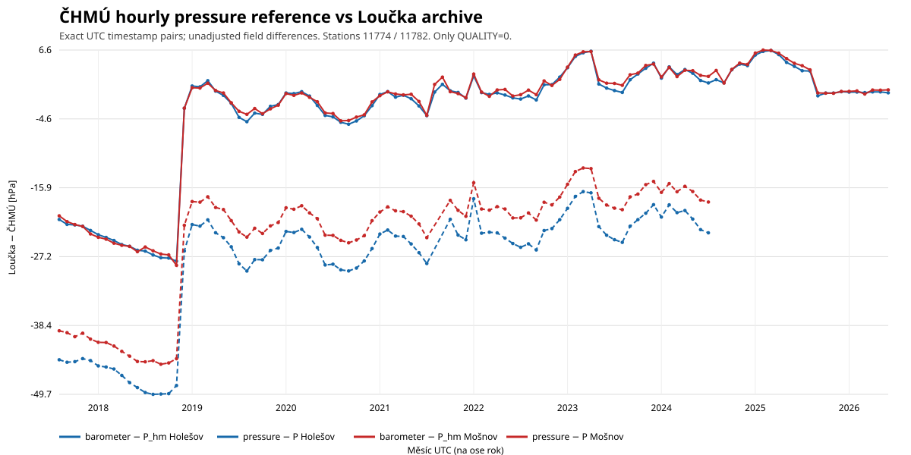
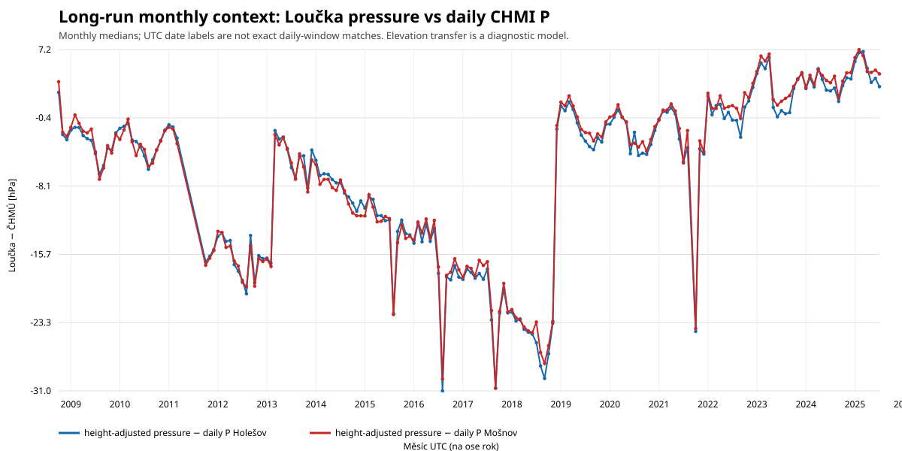

# Numerické porovnání tlaku Loučky s ČHMÚ 2009–2026

**Datum běhu:** 23. 11. 2026. **Navazuje na:** sloučený PR #88 a report [pressure-2009-2026-chmi-readonly-20261123.md](pressure-2009-2026-chmi-readonly-20261123.md).

## Výsledek

- Byla stažena a numericky zpracována oficiální denní P řada Holešova (11774) a Mošnova (11782), hodinová P a P_hm za 2018–2024 tam, kde byly publikovány, P_hm za 2025 a dostupná hourly/recent data 2026. Recent denní JSON pro obě stanice je dostupný do **22. 11. 2026**.
- Přesné hodinové párování používá shodný UTC timestamp a ČHMÚ `QUALITY=0`. Má **495 270 porovnání řádek–stanice–prvek–pole**; výsledky jsou v ročních a měsíčních CSV. Hodinový soubor není hodinové průměrování celé předchozí hodiny: jde o hodinový SYNOP záznam a WeeWX archivní bod, takže párování ukazuje souběžný průběh a bias, nikoli identickou expoziční dobu.
- V denním období 2009–2017 hodinová ČHMÚ data nejsou. Pro tyto roky report uvádí pouze měsíční kontext denního `P` s `TIMEFUNC=AVG`; denní štítky nejsou naivně párovány s UTC dnem archivu. Výškově upravené měsíční mediány jsou diagnostický model, nikoli validace jednotlivých hodnot.
- Zjištěn je výrazný zlom kolem **května 2019**. Medián `barometer − P_hm` (Holešov) se změnil z přibližně −28,2 hPa v dubnu na −2,9 hPa v květnu; výškově upravené `pressure − P` se změnilo z −46,0 na −24,1 hPa. Požadavek „od dubna 2019“ je tedy podpořen změnou na přelomu dubna/května v nezávislé ČHMÚ řadě; samotný důvod změny ani konfigurace WeeWX z ní určit nelze.
- Od 2022 odpovídá `pressure` po transportu na výšku stanic ČHMÚ jejich staničnímu P zhruba v řádu jednotek hPa. `barometer` je v 2022–24 blízko P_hm. V roce 2025 se medián `barometer − P_hm` posouvá na +4,38 hPa (MAD 1,42); v dostupných datech 2026 je −0,22 hPa (MAD 0,63). To nezávisle potvrzuje změnu vztahu polí/epoch, ale nepřiřazuje ji konkrétnímu senzoru ani GW1000 kopii.
- **Bezpečně doložený seznam kandidátů obnovy je prázdný.** WH1080/old_weewx/GW1000 archivní databáze nejsou dostupné existujícím LXC účtem `loucka_web_ro`; tento účet má SELECT do `loucka_reconstruction.archive`, nikoli do archivních kopií. PR #88 už uvádí 75 074 WH1080 hodnot, které jsou na stejných timestampích totožné s old_weewx (jedna sdílená datová linie), ale bez jednotlivých zdrojových hodnot a dalšího časového párování nelze žádnou konkrétní náhradu schválit. `recovery_candidates.csv` proto obsahuje pouze hlavičku.
- Rok 2022 má v aktuálním pracovním snapshotu **46 305 NULL `pressure`**; podle inventury v PR #88 má **45 069** z nich nulovou přímou náhradu ve všech dostupných kopiích. Zde nebyla vytvořena žádná modelovaná hodnota. Modelování prázdných intervalů by vyžadovalo samostatnou metodiku a musí zůstat jasně odlišeno od měření.

**Žádné meteorologické hodnoty nebyly zapsány, změněny ani smazány.** Nebyl spuštěn APPLY/ROLLBACK, INSERT, UPDATE ani DDL. Produkční databáze, živý WeeWX a denní souhrny nebyly měněny. Nebyl vytvořen SQL účet ani databáze.

## Oficiální zdroje, struktura a dostupnost

Zdrojem je [ČHMÚ historical CSV](https://opendata.chmi.cz/meteorology/climate/historical_csv/), [recent data](https://opendata.chmi.cz/meteorology/climate/recent/data/1hour/) a [oficiální popis dat](https://opendata.chmi.cz/meteorology/climate/Klimatologicka_data_popis.pdf). Popis ČHMÚ uvádí hodinová SYNOP data P a P_hm od roku 2018 a formát hourly souborů; recent hourly měsíční soubory se obnovují, zatímco současný měsíc je publikován po dnech. Denní CSV obsahuje termíny a agregát. [Metadata meta1](https://opendata.chmi.cz/meteorology/climate/historical/metadata/meta1.json) určují časově platné souřadnice a výšku stanic, [meta2](https://opendata.chmi.cz/meteorology/climate/historical_csv/metadata/meta2.csv) popisuje prvky, jednotky a výšky měření a [meta4](https://opendata.chmi.cz/meteorology/climate/historical_csv/metadata/meta4.csv) význam quality kódů.

| Sada | Pozorovaná struktura / jednotka | Dostupnost v tomto běhu |
|---|---|---|
| Denní P CSV | `STATION,ELEMENT,TIMEFUNC,DT,VALUE,FLAG,QUALITY`; P v hPa; více řádků za den (`AVG`, 06:00, 13:00, 20:00) | Holešov i Mošnov; oba soubory staženy, řádky od 1961; srovnání pokrývá 2009–2026 |
| Historické hodinové CSV | `STATION,ELEMENT,DT,VALUE,FLAG,QUALITY`; P/P_hm v hPa; DT zakončeno `Z` | Úplné soubory 2018–24 pro oba prvky a obě stanice; 2025 P_hm dostupné, P pro obě stanice není v ročním adresáři publikováno (24 chybějících souborů) |
| Recent měsíční JSON | `data.data.values`, 6 položek včetně timestampu, flag a quality | 2026-01 až 2026-10: 20 souborů (2 stanice × 10 měsíců) |
| Recent denní JSON | tentýž záznamový formát, timestamp UTC | 44 souborů pro 1.–22. 11. 2026 (22 dní × 2 stanice); poslední dostupný den 22. 11. |

Manifest `data/chmi-pressure-2009-2026/manifest.json` zaznamenává URL, dostupnost, velikost a SHA-256 každého zdrojového souboru včetně oficiálních metadat a PDF. Obsahuje **426 dostupných souborů, 28 cest, které v čase stažení nebyly publikovány, a 0 HTTP/fetch chyb**. Raw zdrojová data zůstávají lokální mimo Git; lze je obnovit downloaderem. Adresářní dostupnost je časově proměnná, zejména recent část.

Přesné CSV hlavičky byly zachovány v parseru. Jednotku hPa potvrzuje meta2 (`UN_DESCRIPTION`). `FLAG` je oddělen od `QUALITY`; všechny stažené tlakové záznamy měly prázdný `FLAG`. Kódy meta4: 0 kvalitní, 1 podezřelá, 2 nízká kvalita, 3 odhadnutá, 4 chybějící, 5 neznámá. Do párovaných statistik jde pouze 0/0.0; záznamy 3, 4 a 5 jsou vyřazeny jako nepřímé/nejisté. Nalezené počty: denní 191 682 kvalitních + 78 odhadnutých; historické hourly 262 106 kvalitních + 44 odhadnutých + 842 chybějících; recent (měsíční a denní, pouze P/P_hm) 15 144 kvalitních + 23 odhadnutých + 481 s neznámou kvalitou. Parser nezaznamenal duplicitní hodinový klíč ani timestamp bez výslovného `Z`.

Denní `DT` je datumový štítek v CSV, zatímco `TIMEFUNC` odděluje průměr a termíny. Jeho hodnota nebyla považována za přesný UTC okamžik měření. Souběžné hodinové páry mají explicitní UTC `Z`; Unix `archive.dateTime` byl převeden přes UTC. Neprovádí se lokální CET/CEST posun.

## Stanice a výšková korekce

| Stanice | WSI | Poloha z meta1 | Výška stanice | Změna v období |
|---|---|---|---:|---|
| Holešov | 0-20000-0-11774 | 49.320556 N, 17.570000 E | 222,25 m | 19. 6. 2009: 223,6 → 222,3 m; od 1. 7. 2009 222,25 m |
| Mošnov | 0-20000-0-11782 | 49.691944 N, 18.112778 E | 252,8 m | do 23. 5. 2016 250,4 m; od 24. 5. 2016 252,8 m |
| Loučka | — | poloha v tomto průchodu nezjištěna | **425 m** (zadáno vlastníkem) | nadmořská výška držena konstantní dle zadání |

ČHMÚ `P` je staniční tlak; `P_hm` je tlak redukovaný na hladinu moře. Loučkův `pressure` je při diagnostickém srovnání považován za staniční tlak a `barometer` za redukovaný, ale názvy polí samotné tuto sémantiku nedokazují. `pressure`–`P` je proto upraven hypsometrickým vztahem z 425 m na výšku stanice ČHMÚ s Loučkovým `outTemp` jako reprezentativní teplotou sloupce. Všech **1 697 435** řádků analytického snapshotu mělo `usUnits=16` (WeeWX METRIC; tlak hPa a `outTemp` °C). Je to **modelovaný diagnostický převod**, nikoli pozorovaná hodnota. `barometer` se porovnává přímo s P_hm. Žádná pevná výšková konstanta se nepoužívá napříč epochami.

## Hodinové numerické výsledky od 2018

Tabulka uvádí roční medián a MAD rozdílu při přesném UTC párování na Holešov. `n` je počet párů; kompletní statistics jsou ve `hourly_annual_stats.csv`, všechny měsíční mediány a MAD v `hourly_monthly_stats.csv`.

| Rok | barometer − P_hm: n / medián / MAD | `pressure` − P_hm: n / medián / MAD | `pressure` po transportu na 222,25 m − P: n / medián / MAD |
|---:|---:|---:|---:|
| 2018 | 7 261 / −24,27 / 1,30 | 4 242 / −72,32 / 1,74 | 4 242 / −22,84 / 1,57 |
| 2019 | 8 670 / −2,57 / 3,27 | 7 049 / −51,57 / 3,15 | 7 049 / −0,88 / 2,00 |
| 2020 | 8 181 / −2,50 / 1,70 | 7 698 / −52,93 / 2,95 | 7 698 / −2,02 / 1,69 |
| 2021 | 8 415 / −2,41 / 1,69 | 8 322 / −52,98 / 2,91 | 8 322 / −1,87 / 1,65 |
| 2022 | 8 542 / −0,50 / 0,94 | 4 829 / −50,90 / 1,59 | 4 829 / −0,26 / 0,75 |
| 2023 | 8 697 / +1,54 / 2,10 | 8 650 / −48,70 / 3,42 | 8 650 / +1,91 / 2,13 |
| 2024 | 8 737 / +2,49 / 1,19 | 8 592 / −47,63 / 2,25 | 8 592 / +2,84 / 1,16 |
| 2025 | 8 558 / +4,38 / 1,42 | 8 245 / −46,31 / 2,58 | hodinový P v adresáři chybí |
| 2026 do 22. 11. | 7 534 / −0,22 / 0,63 | 7 531 / −50,06 / 1,24 | hourly P v recent řezu nedostupná |

U Mošnova se roční mediány `barometer − P_hm` pohybují v témže režimu: 2018 −24,48; 2019 −2,30; 2020 −2,28; 2021 −1,93; 2022 −0,10; 2023 +2,22; 2024 +2,83; 2025 +4,78; 2026 −0,04 hPa. Dvojí stanice nezávisle potvrzuje načasování velkých změn, byť jsou ovlivněny regionálním tlakovým polem a vlastním station history.



### Dlouhodobý denní kontext 2009–2017

Zde je medián přes měsíční robustní rezidua obou ČHMÚ stanic: Loučkův `pressure` po výškovém modelovém transportu minus denní `P` `TIMEFUNC=AVG`. `MAD` a `n` se počítají z dostupných měsíčních station–měsíc hodnot. Nejde o přesný časový join; roky 2009–2011 mají kvůli výpadkům ČHMÚ méně měsíců.

| Rok | Měsíční body n | Medián / MAD (hPa) |
|---:|---:|---:|
| 2009 | 20 | −2,00 / 0,49 |
| 2010 | 24 | −3,47 / 1,18 |
| 2011 | 16 | −3,01 / 1,26 |
| 2012 | 20 | −15,61 / 1,33 |
| 2013 | 24 | −15,29 / 4,00 |
| 2014 | 24 | −7,25 / 0,80 |
| 2015 | 24 | −10,98 / 0,90 |
| 2016 | 24 | −13,60 / 0,83 |
| 2017 | 24 | −17,78 / 0,55 |

To indikuje několik změn zdrojové epochy nebo kalibrace před 2018, zejména 2012, 2014 a 2016–17. Bez dobové konfigurace a raw řetězce senzorů jim nepřiřazuji příčinu. Měsíční kontextová grafika je oddělena od přesných hodinových párů.



## Change points a vztah k dříve popsaným epochám

- Automatický screening ročních/měsíčních mediánů (skok ≥5 hPa, sloučený medián obou stanic) navrhuje květen 2019 pro obě pole; dále změny `pressure−P` v březnu a červnu 2022 a říjnu 2023. Výsledky jsou v `change_point_candidates.csv`, ne klasifikace příčiny.
- Květnový zlom je velký a současný v obou nezávislých stanicích. Znamená, že srovnání old_weewx/WH1080 přes duben 2019 musí rozdělit starší a novější kalibrační období. **Přímé nové přepočítání rozdílu starého archivu není možné z povoleného LXC účtu**, protože zdrojové DB kopie nejsou tímto SELECT účtem přístupné. PR #88 předchozí rozdíl old_weewx–WH uvádí, ale tato ČHMÚ analýza jej nepotvrzuje jako stejný zdrojový mechanismus.
- PR #88 zaznamenal změnu `barometer−pressure` v kopii GW1000 v letech 2024–26 (~51,4 → 44,4 → 39,4 hPa). Tato kopie nebyla v tomto LXC SQL přístupu dostupná. Nezávislé ČHMÚ srovnání však pozoruje posun `barometer−P_hm` do +4,4 až +4,8 hPa v roce 2025 a blízko nuly v roce 2026; tím potvrzuje změnu relationship lokálního pole, nikoli přesnou změnu v GW kopii nebo výškový parametr.
- Dva vyčíslené zlomové měsíce a měsíční řady jsou ve změnových CSV/grafu. Neznámá konfigurace WeeWX, výměna HW a výška senzoru zůstávají nejistotou pro klasifikaci příčin.

## Chybějící `pressure`, WH1080 a rok 2022

Aktuální SELECT snímek v `loucka_reconstruction.archive` obsahuje **1 697 435 řádků** pro analytický běh 29. 3. 2009 16:45 UTC až 23. 11. 2026 18:10 UTC. Počet se průběžně měnil při opakovaných čteních (předchozí kontrolní SELECT našel 1 697 434 řádků); archiv se v roce 2026 doplňuje. Pro analyzovaný snapshot vychází **198 175 NULL `pressure`**, stejně jako PR #88; roční počty jsou v `loucka_monthly_coverage.csv`.

Z toho jsou důležité úseky:

| Rok | NULL `pressure` v snapshotu | Podklad |
|---:|---:|---|
| 2016 | 15 727 | PR #88: 3 764 WH1080 přímých časových hodnot |
| 2017 | 28 287 | PR #88: 25 189 WH1080 přímých časových hodnot |
| 2018 | 46 542 | PR #88: 46 121 WH1080 přímých časových hodnot |
| 2022 | 46 305 | PR #88: 45 069 bez přímého zdroje v pěti kopiích |

PR #88 uvádí přesnou shodu 75 074 WH1080–old_weewx hodnot; shoda kopií neznamená nezávislé ověření. Navíc 2018 CHMI páry ukazují po výškovém přepočtu zbytkový medián `pressure−P` −22,84 hPa (MAD 1,57), zatímco 2019–22 je blízko nuly. Z dostupných dat proto nelze označit 2016–18 WH hodnoty za spolehlivé k převzetí. **Počet WH1080 hodnot splňujících standard pro konkrétní kandidát v tomto běhu: 0 ověřitelných, protože zdrojové řádky nejsou dostupné přes oprávněný účet.** To neříká, že všech 75 074 je chybných; pro jejich posouzení je nutný autorizovaný read-only export původních řádků.

Pro rok 2022 není žádná archivní kopie pro 45 069 hodnot a ČHMÚ v okolí nabízí jen regionální souběžný tlak, nikoli původní měření v Loučce. Bez modelu validovaného na časových holdoutech a lokálních meteorologických vstupů nevytvářím odhad. V reportu nejsou měřené hodnoty zaměněny za interpolace.

## SQL režim, reprodukce a artefakty

Použitý existující účet: `loucka_web_ro@192.168.0.131`, host `lo-infra-db-mariadb01`, `server_id=1`. Finální reprodukovatelný skript používá `START TRANSACTION READ ONLY` a SELECT; při prvním prototypu byl navíc proveden read-only `SHOW COLUMNS`, než byl nahrazen SELECTem z `information_schema`. Archivní kopie `weewx_WH1080`, `old_weewx`, `pocasi-loucka.eu_GW1000` a `pocasi-loucka.eu_old` byly nedostupné a nebyly dotazovány. Pracovní DB snapshot četl pouze `dateTime, usUnits, interval, pressure, barometer, outTemp, inTemp` z `loucka_reconstruction.archive` v `[2009-01-01 00:00:00 UTC, 2027-01-01 00:00:00 UTC)`. Výsledek CSV neobsahuje archivované jednotlivé měřicí řádky; obsahuje agregace a referenční časové páry.

Reprodukovatelný postup na LXC s existujícím read-only cnf:

```sh
python3 scripts/fetch_chmi_pressure_history.py
python3 scripts/analyze_chmi_pressure_history.py --cnf /cesta/k/existujicimu-readonly.cnf
python3 scripts/build_pressure_chmi_charts.py
```

Raw soubory jsou ponechány lokálně; přístupové soubory/hesla nejsou součástí repozitáře. Důkazy a agregace:

- `data/chmi-pressure-2009-2026/manifest.json` — URL, SHA-256, byte velikost a dostupnost původních zdrojů; SHA-256 manifestu viz `analysis.json`.
- `hourly_annual_stats.csv`, `hourly_monthly_stats.csv` — medián, MAD, průměr, SD, p05/p95, n podle roku/měsíce, stanice, prvku a pole.
- `hourly_station_pressure_height_adjusted.csv` — explicitně modelované výškové přepočty `pressure` vs P.
- `daily_chmi_monthly_context.csv` — coarse monthly trend 2009–2026; bez tvrzení o přesném časovém páru.
- `daily_monthly_stats.csv`, `loucka_monthly_coverage.csv` — oddělené termíny/daily avg a roční/měsíční nulové pokrytí.
- `change_point_candidates.csv`, dvě SVG časové řady, `recovery_candidates.csv` (0 kandidátů).

Před APPLY by musel existovat konkrétní per-field zdrojový manifest, kontrola aktuálního old-value a samostatný souhlas vlastníka. Tento PR takový souhlas ani nenahrazuje.
